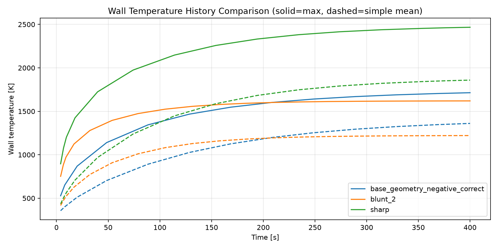
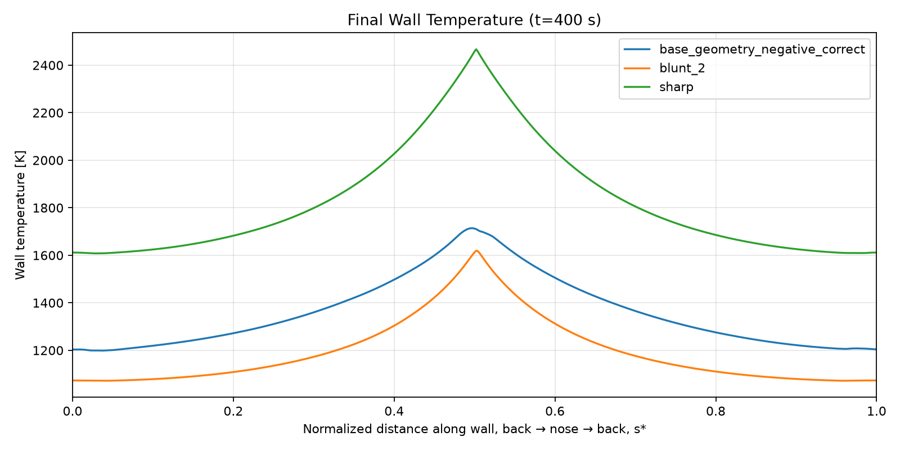

# AE496 — hypersonic nose study

A config-driven **planar 2-D CFD → transient thermal → nose comparison** workflow
using licensed Ansys 2025 R1, PyFluent, SpaceClaim and MAPDL. One command handles a
case or batch; reports read saved data and do not rerun simulations.

## Start on Windows

Use a fresh project folder, keep your CAD files in `geometry_batch/`, and run
these commands from the repository root. Python 3.12 is the tested version;
the pinned numerical dependencies require Python 3.12 or later.

```powershell
py -m venv .venv
.\.venv\Scripts\python.exe -m pip install -r requirements.txt
.\.venv\Scripts\python.exe study.py run --geometry ".\geometry_batch\blunt_1.x_t" --stop-after mesh
```

Inspect that first mesh and its inflation layer before proceeding. SpaceClaim
251 is selected explicitly because that backend worked on your installation.
The geometry must be **one XY fluid surface: outer farfield minus body hole**.
No CAD or fabricated simulation outputs are included in this repository.

Resume that case through the complete workflow:

```powershell
.\.venv\Scripts\python.exe study.py run --geometry ".\geometry_batch\blunt_1.x_t"
```

Run all geometries sequentially, or regenerate reports separately:

```powershell
.\.venv\Scripts\python.exe study.py batch --batch-config batch.yaml
.\.venv\Scripts\python.exe study.py report --runs-dir runs
```

An existing case config can be used directly:

```powershell
.\.venv\Scripts\python.exe study.py run --config ".\runs\blunt_1\_batch\config.yaml"
```

The familiar older entry points remain thin compatibility wrappers, all using
`--config` for case selection. They share the same implementation.

## Configuration and physics

- `config.yaml`: common CFD/mesh template. The batch replaces `project.name`,
  `project.work_dir`, and `geometry.input_file` for each nose.
- `batch.yaml`: geometry directory, sequential execution, resume and limits.
- `thermal_analysis.yaml`: material, duration, thermal mesh, radiation and plots.

**New airflow points toward −X into the +X nose**, as confirmed. Drag is positive
along the configured flow; lift uses its perpendicular. Existing historical
results are not rotated or relabeled when settings change.

Fluent uses an explicit reference wall temperature to calculate heating.
MAPDL then applies **direct prescribed heat flux**, with evolving solid
conduction temperature and optional radiation. That reference temperature does
not constrain the solid temperature. There is **no adiabatic-reference stage**,
no endpoint-derived film coefficient, and no hidden fallback between models.
The prescribed CFD flux is not recomputed as the solid heats; this is a screening
assumption, not two-way CFD/thermal coupling.

The export field name and raw-to-into-wall sign are explicit in
`thermal_export`. Check them on your known case before batch heating analysis;
the code never automatically flips values to obtain positive heating. You can
inspect the available saved-case fields with:

```powershell
.\.venv\Scripts\python.exe study.py export --config ".\runs\blunt_1\_batch\config.yaml" --inspect-fields
```

Aerodynamic outputs are **N/m of span**, appropriate for planar sections.
`Cd` and `Cl` stay undefined until `aero.reference_area_per_unit_span_m` is set
to a justified common reference width (`A_ref / span`). No 3-D area is guessed.
Reference normalization uses the configured perfect-gas gamma and R. Total
forces include pressure and viscous contributions; a separate split is not yet
reported. `design_limits.max_temperature_k` is optional and never invented.

The solid outline/mass estimate is reconstructed from CFD wall-face centroids,
with filled uniform-material cross-section assumptions. Review temperature
limits, constant material properties, gas model, convergence and mesh sensitivity
before making a final nose selection.

## Data and resume

Every nose has one authoritative directory:

```text
geometry_batch/<nose>.x_t
runs/<nose>/
  _batch/config.yaml          # exact case selection
  _batch/stage_state.json     # stage input/output fingerprints
  01_labeled_geometry.pmdb/
  02_mesh.msh.h5
  03_setup.cas.h5
  04_final.cas.h5
  04_final.dat.h5
  summary.json
  aero_summary.json
  thermal_bc/body_wall_faces.csv
  thermal_analysis/
    thermal_summary.json
    temperature_history.csv
    wall_temperature_history.csv
    wall_temperature_final.csv
    thermal_nodes_final.csv
    thermal_snapshots.npz
    visualization/           # temperature/flux maps, histories, optional GIF
  reports/                   # per-nose wall history/profile CSVs and plots
  batch_logs/
runs/comparison/             # cross-nose CSVs, plots and trade screening
```

Resume checks mesh, solver, export, forces and thermal stages independently.
Changing inputs invalidates affected stages using SHA-256 fingerprints;
completed upstream stages remain reusable. Previous artifacts are retained in
`runs/<nose>/_history/` before replacement. Older results without fingerprints
can be adopted with explicitly unverified provenance rather than discarded.

Wall comparisons preserve **maximum as solid, mean as dashed, one color per
nose**. The mean is explicitly the arithmetic mean of saved wall samples,
separate from the nodal mean of the entire solid. Final profiles use back → nose
→ back; new normalized profiles map each side's physical arc length to half the
range, while original physical distances remain in the CSV. Imported normalized
positions remain exactly as supplied. Drag/heating/temperature trade plots show
screening Pareto candidates, not an automatically selected winner.

## Existing result examples

The supplied historical CSVs are retained under `examples/reference_results`.
They contain results from the previous project, including legacy convection
columns, and **are not new simulations of the direct-flux model**. Reproduce
those comparisons without installing/running Ansys products:

```powershell
.\.venv\Scripts\python.exe study.py report --reference-dir examples/reference_results --output-dir examples/reference_report
```





## Validation and cloud use

Unit tests cover numerical data, wall mapping, force normalization, workflow
adapters, stage-aware resume and saved-result reports. Ansys calls use fixtures
in tests; **a licensed Windows full-case run is still required** to verify the
rebuilt meshing/export/thermal adapters, especially boundary-layer scope and
heat-flux field/sign. Completing iterations does not certify convergence.

```powershell
.\.venv\Scripts\python.exe -m unittest discover -s tests -v
```

The cloud machine supports Python development and offline reports. Its PyAnsys
client imports and dependencies are checked, but it has no Ansys products
installed. Set it up from the existing checkout with `bash scripts/setup_cloud.sh`;
source `scripts/activate_cloud.sh` in subsequent shells for writable caches and
the prepared virtual environment. No Git worktree is needed for cloud tasks.
