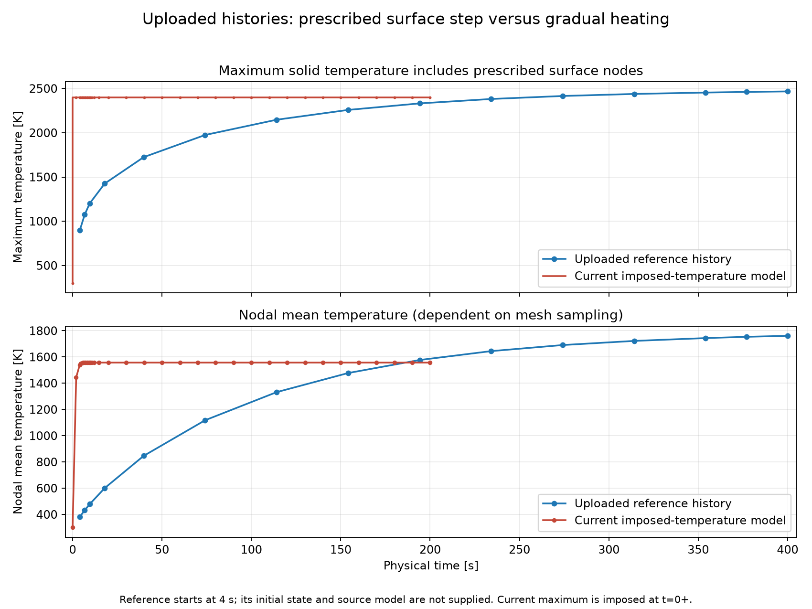

# Physical warm-up and current model accuracy

This review describes the implementation at `8421b3f` and the two uploaded
histories. The recommendations below are proposed model changes, not additional
configuration options already implemented.

## What the uploaded histories show

| Quantity | `temperature_history_correct.csv` | `temperature_history.csv` |
|---|---:|---:|
| First saved time | 4 s | 0 s |
| Maximum at 4 s | 895.9 K | 2398.5 K |
| Mean at 4 s | 381.9 K | 1540.9 K |
| Final time | 400 s | 200 s |
| Final maximum | 2467.1 K | 2398.5 K |
| Final nodal mean | 1761.1 K | 1557.0 K |

The new maximum is exactly constant after the first solved time. Mechanical
prescribes the CFD equilibrium temperature on every surface node, with a step
at t=0+. The reported solid maximum includes those constrained nodes. It is
therefore a prescribed maximum, not a prediction of surface warm-up. The
interior still changes by conduction. This is not an adiabatic solid boundary.

The older curve is consistent with finite heating, but its filename and curve
shape do not validate its heat input, material properties, geometry or flight
conditions. Its initial state before 4 s is not supplied in that CSV. These
files should not be treated as a controlled comparison of identical models.

## Transfer model needed for warm-up

The active Fluent wall solves an approximate local radiation equilibrium:

`q_gas = epsilon * sigma * (Ts^4 - T_environment^4)`.

It includes neither solid thermal storage nor conduction through the nose.
Mechanical then enforces that equilibrium Ts, bypassing the finite gas-side
thermal resistance. The single equilibrium result does not identify how gas
heat transfer changes at other surface temperatures.

For warm-up, solve transient solid conduction with temperature-dependent
properties and a heat-transfer boundary:

`rho * cp(T) * dT/dt = divergence(k(T) * gradient(T))`

`q_net = q_gas(s, Ts, flight(t)) - epsilon(Ts) * sigma * (Ts^4 - T_environment^4)`.

Here Ts is computed by the solid solver. One approximation for q_gas is
`h(s, Ts, flight) * (T_aw(s, flight) - Ts)`. T_aw is a recovery reference;
an arbitrary near-wall fluid-cell temperature is not interchangeable with it.
Gas heating commonly decreases as Ts approaches the recovery temperature;
it is not generally proportional to 1/Ts. At high gas temperatures an
enthalpy-based representation is more appropriate than assuming constant cp.

Recommended implementation:

1. Retain the current Ansys launch, mesh, drag/lift, caching and plotting tools.
2. Calibrate gas-side wall heat flux with a small set of converged CFD cases at
   selected wall temperatures spanning the expected solid temperatures, and
   representative flight states. Record the wall temperature and signed flux
   at the same spatial locations. Do not include external wall radiation in
   this gas-side calibration and then subtract it a second time.
3. Interpolate the resulting q_gas lookup during the Mechanical transient
   solve, using the evolving local surface temperatures. Radiation belongs on
   the solid boundary in this formulation. Update/iterate the loads within
   the thermal step as necessary and check energy conservation and step size.
4. Supply measured/published property tables and a flight-state time history.
   Reject requests outside calibrated ranges or explicitly assess their
   extrapolation. Do not silently clamp temperatures or invent coefficients.
5. Save physical-time surface and interior histories, temperature profiles,
   sectional forces and integrated heat/energy diagnostics separately.

A uniform-wall-temperature CFD library approximates spatial and upstream
boundary-layer effects; it is not equivalent to solving CFD with the actual
nonuniform wall-temperature field. Periodic CFD updates with the Mechanical
surface field, or conjugate heat transfer, are stronger verification options.
Gas flow can often be treated as quasi-steady relative to a seconds-long solid
response; a physical-time CFD solve is not automatically required.

The retained two-endpoint implementation is an intermediate option: it derives
spatial h from cold-wall and adiabatic CFD and uses convection in Mechanical.
It predicts warm-up, but keeps that derived h fixed as the wall warms. A cold
reference is a calibration measurement, not a requirement that the actual
solid stay cold. Current single-solve prescribed loading cannot be changed to
this or the proposed lookup model merely by setting `include_radiation: true`.

## Current assumptions and their importance

No defensible percentage error can be assigned from these CSVs alone. The
following priorities are based on model structure and the temperature range;
material/surface data, trajectory and validation are still needed.

| Factor | Current implementation | Accuracy implication / improvement |
|---|---|---|
| Surface loading and thermal storage | Equilibrium Ts prescribed at t=0+ | Dominant mismatch for warm-up; replace with finite heat transfer and thermal storage. |
| Flight history | Mach 8, 1090 Pa, 226.5 K, fixed direction for the whole exposure | 200 s is duration at one condition, not a changing flight envelope. Provide time-dependent Mach or velocity, pressure, temperature and angle of attack. |
| Gas heat transfer versus wall temperature | Not transferred as a heating law | Calibrate multiple warm-wall states or use verified correlations/enthalpy models; neither one equilibrium Ts nor gas temperature alone determines heat rate. |
| Tungsten conductivity | Constant 170 W/(m K) | Usually decreases with temperature; a room-temperature constant can spread heat too rapidly and reduce predicted gradients. Use k(T) for the actual grade. |
| Tungsten heat capacity | Constant 130 J/(kg K) | Generally rises with temperature; a low constant can understate stored energy and accelerate heating. Use cp(T). |
| Tungsten density/expansion | Constant 19250 kg/m3; fixed geometry | Commonly a smaller thermal correction than k/cp, but expansion affects density, contact and structural response. Treat consistently if included. |
| Emissivity | CFD epsilon=0.9 constant | A large, unverified assumption for clean unoxidized tungsten. Use total hemispherical epsilon(T) for the declared surface finish/state. Its importance grows with Ts^4. |
| Oxidation/coatings/roughness | No evolving surface state | Freeze a declared surface state for the requested study. Temperature dependence alone does not model oxidation; carry that exclusion into uncertainty statements. |
| Gas cp and conductivity | Native Fluent air settings; not explicitly configured/read back by this script | No demonstrated high-temperature property treatment. Configure and record appropriate cp(T), gas conductivity and transport data. |
| Gas density and viscosity | Ideal gas and Sutherland viscosity | Temperature-dependent viscosity is already included, but this alone does not establish accurate high-temperature thermodynamics/chemistry. Validate applicability. |
| Gamma and gas constant | Reporting/initialization use gamma=1.4, R=287.05 | Calorically perfect reference assumptions. Match initialization, Mach/velocity, normalization and gas-property treatment consistently. |
| Gas chemistry and wall catalysis | No reacting species or catalytic-wall treatment | Assess dissociation/recombination at the actual enthalpy and pressure. Variable cp does not replace chemistry; chemical wall heat transfer may matter even without modelling oxide growth. |
| Boundary-layer state | Laminar | Transition/turbulence and roughness can substantially change both heating and viscous drag. Compare justified regimes and sensitivities. |
| Solid/body geometry | Reconstructed planar closed nose, unit span, fixed shape | Appropriate for the supplied planar sections. Three-dimensional tip flow and attachment to the rest of the vehicle are not included. Check thickness/mass and actual rear-contact conduction. |
| Radiation surroundings | CFD environment=3 K; local external-loss model | Check view factors, Earth/sky/solar/environmental loads as relevant. At a very hot surface, emissivity generally matters much more than changing a cold surroundings temperature modestly. Mechanical emissivity fields currently do not drive prescribed-surface warm-up. |
| Surface radiation versus shock-layer radiation | External wall radiation only; Fluent volume radiation disabled | Gas radiation is a separate phenomenon. Assess whether it is material at the flight enthalpy; adding a volume model alone does not fix surface storage. |
| CFD numerical accuracy | First-order upwind, Courant 0.3; residual screen 1e-3 | Conservative startup, not a quantified temperature error. Demonstrate stable heat/force monitors, grid/domain sensitivity and suitable higher-order verification. |
| Mesh and load mapping | CFD vertices reconstructed and interpolated to FE boundary nodes; automatic solid mesh | Verify the thermal mesh/time step, near-tip geometry and integrated heat conservation in a flux-transfer implementation. |
| Reported mean | Arithmetic mean of nodal temperatures | Depends on mesh sampling. Add volume/mass-weighted mean and total sensible energy for cross-nose comparisons. |
| Mechanical failure | Constant-property thermal solve only | A temperature below melting does not establish viability. Thermal stress, temperature-dependent strength, creep, melting/latent heat and geometry loss require separate treatment when relevant. |

For emissivity, a temperature table for a fixed clean surface can be useful
without simulating oxidation. A spectral emissivity value at one instrument
wavelength is not the total hemispherical emissivity needed for integrated
radiative heat loss. Do not fit epsilon(T) to reproduce the older curve.

MAPDL supports temperature-dependent material tables; the current code uses
only scalar MP values. A temperature-dependent radiation implementation must
likewise use supported native material/radiation tables or update and iterate
the surface law explicitly. The existing scalar SFL RAD coefficient does not
automatically become epsilon(T) by adding an unused YAML table.

## The 7000 K concern and relevant time scales

Using the configured reporting assumptions, the calorically perfect stagnation
estimate is `T0 = 226.5 * (1 + (1.4-1)/2 * 8^2) = 3125.7 K`. A 7000 K value at
those conditions needs investigation of field meaning, actual material model,
boundary conditions, flight inputs, units and numerical convergence. It is not
explained by selecting a cold wall. Static gas, recovery, stagnation and solid
temperatures must retain distinct labels. With variable cp or chemistry,
compute stagnation state from enthalpy conservation instead of this formula.

The current constant tungsten diffusivity is about `6.79e-5 m2/s`. The
conduction scale `L^2/alpha` is about 0.37 s across 5 mm and 1.47 s across
10 mm, versus about 147 s across 100 mm. These are internal conduction scales,
not complete exposure-heating predictions. A thin, conductive nose may still
respond rapidly under finite heating. Its warm-up depends on heat input,
radiative losses, mass, geometry and thermal connections. An arbitrary ramp
to the equilibrium temperature would merely prescribe a desired history.

Recommended order: correct the loading model, verify gas thermodynamics and
surface/material data, add the flight timeline, then quantify numerical and
physical sensitivities. Use the older CSV as a reference to explain, not a
curve to force the new analysis to match.
